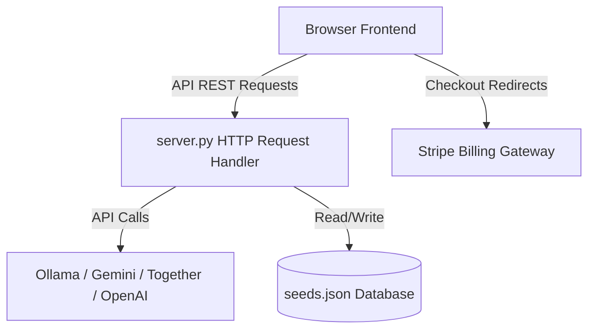

# Architecture Specification

### Components
* **API Handler**: Custom class extending python's `BaseHTTPRequestHandler`. Implements thread-safe file operations, JSON responses, and CORS preflight.
* **Extraction Pipeline**: Unified orchestrator with tiered fallback adapters.
* **Sovereign Client-side Platform**: Handles token auth, mock persistence, and clean URL redirects.
